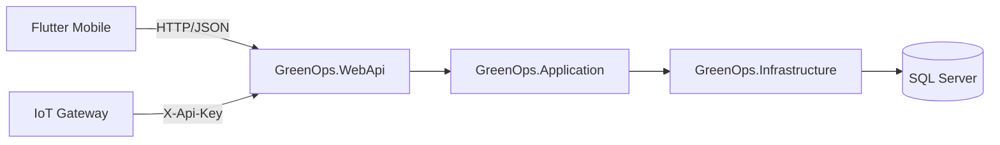

# GreenOps CarbonTrace - Teknik Proje Raporu

Bu dokuman, GreenOps CarbonTrace platformunun teknik mimarisini, calisma bicimini ve gelistirme ortami kurulumunu aciklar.

GreenOps CarbonTrace; karbon emisyonlarinin kaydi, izlenmesi, raporlanmasi ve yonetimi icin tasarlanmis cok kiracili (multi-tenant) bir platformdur.

## 1. Proje Ozeti

Platform 2 ana katmandan olusur:

- Backend: .NET 8 Web API, JWT kimlik dogrulama, EF Core SQL Server
- Mobil istemci: Flutter (Android emulator hedefli gelistirme)

Ana islevler:

- Kimlik dogrulama (TOTP 2FA dahil), rol bazli erisim ve sirket (tenant) izolasyonu
- Emisyon girisi (faaliyet donemi + katsayi denetim izi), onay/red surecleri ve CSV toplu yukleme
- Dashboard KPI ve trend analizleri
- Sirket, tesis, kullanici ve tedarikci yonetimi
- Hedef, karbon kredisi, lisans ve faturalama modulleri
- Yetki kontrollu dokuman yukleme/indirme
- CSV veri export (ISO 14064 / GHG Protocol PDF uretimi henuz yok)
- Entegrasyonlar (hash'li API anahtari, X-Api-Key ile IoT sayac webhook'u)
- Tum veri degisiklikleri icin otomatik denetim logu

## 2. Mimari



- GreenOps.Domain: Entity modelleri
- GreenOps.Application: Servis sozlesmeleri, MediatR komutlari ve FluentValidation pipeline'i
- GreenOps.Infrastructure: EF Core DbContext, repository'ler, servisler, guvenlik yardimcilari (BCrypt, TOTP, token hash), dosya depolama, denetim interceptor'u
- GreenOps.WebApi: Controller'lar (`ApiControllerBase` uzerinden tenant/rol kontrolu), JWT, rate limiting, Swagger

## 3. Guvenlik Modeli

- **Tenant izolasyonu:** Sirket kimligi istemciden degil JWT'deki `companyId` claim'inden alinir. Sadece SuperAdmin `companyId` parametresiyle baska sirket secebilir. Baska sirkete ait kaynaklar 404 doner.
- **Roller:** SuperAdmin > CompanyAdmin > Manager > Personnel. Kayit olan kullanici yeni bir sirket acar ve onun CompanyAdmin'i olur; mevcut sirkete katilim sadece davetle olur. CompanyAdmin en fazla Manager/Personnel atayabilir.
- **Oturum:** Her istekte kullanicinin aktifligi, rolu ve sirketi DB'den dogrulanir; pasife alinan veya rolu degisen kullanicinin token'i aninda gecersiz olur. Sifre degisince refresh token'lar iptal edilir.
- **Gorevler ayriligi:** Veriyi giren kisi kendi kaydini onaylayamaz; onaylanmis kayit silinemez.
- **Gizli degerler:** Sifre sifirlama token'lari ve API anahtarlari DB'de SHA-256 hash olarak saklanir.
- **Rate limit:** Auth uclari IP basina dakikada 10, webhook anahtar basina dakikada 120 istek.
- **Dosyalar:** Uzanti, icerik imzasi ve boyut siniri (belge 10 MB, avatar 2 MB); dosyalar web kokunden servis edilmez, yetki kontrollu indirme ucu kullanilir.

## 4. Kurulum ve Calistirma

### 4.1 On Kosullar

- .NET SDK 8.x
- SQL Server (lokal instance, Windows authentication)
- Flutter SDK (Dart 3.8+)
- Android Studio / Android SDK ve bir Android emulator (AVD)

### 4.2 Backend (API)

```powershell
cd backend
dotnet run --project GreenOps.WebApi --launch-profile http
```

- API: `http://localhost:5223`, Swagger: `http://localhost:5223/swagger`
- Baslangicta migration'lar otomatik uygulanir.
- Ilk calistirmada SuperAdmin yoksa olusturulur. `Seed:AdminPassword` bos ise rastgele bir sifre uretilip konsola **bir kez** yazilir.

### 4.3 Flutter (Android emulator)

```powershell
flutter pub get
flutter run -d emulator-5554
```

- Emulator'de `10.0.2.2` host makinenin `localhost`'udur; uygulama varsayilan olarak `http://10.0.2.2:5223/api` adresini kullanir (`lib/services/api_client.dart`).
- Acik metin HTTP sadece `10.0.2.2` icin izinlidir (`android/app/src/main/res/xml/network_security_config.xml`). Baska bir sunucu icin HTTPS kullanin: `flutter run --dart-define=API_URL=https://sunucu/api`.
- VS Code icin `.vscode/launch.json` icinde "GreenOps (Android emulator)" yapilandirmasi vardir.

### 4.4 Release derlemesi (Android)

Uygulama kimligi `com.tigrisecolab.carbontrace`, simge kaynagi `assets/icon/` (`dart run flutter_launcher_icons` ile uretilir).

1. Imza anahtari olusturun (bir kez; dosya ve parolalar depoya girmez, `.gitignore`):
   ```powershell
   keytool -genkeypair -keystore android/greenops-release.jks -storetype PKCS12 -keyalg RSA -keysize 2048 -validity 10000 -alias greenops
   ```
2. `android/key.properties` dosyasini yazin: `storeFile=greenops-release.jks`, `storePassword=...`, `keyPassword=...`, `keyAlias=greenops`.
3. `flutter build apk --release` (cikti: `build/app/outputs/flutter-apk/app-release.apk`; tek mimari icin `--split-per-abi`).

`key.properties` yoksa release debug anahtariyla imzalanir: emulator'de calisir, dagitima uygun degildir. Anahtar kaybolursa ayni kimlikle guncelleme yayimlanamaz; yedekleyin.

## 5. Konfigurasyon

`backend/GreenOps.WebApi/appsettings.json`:

- `ConnectionStrings:DefaultConnection`: SQL Server baglantisi
- `Jwt:Key`: **bos birakilmistir**. En az 32 bayt olmali; yoksa uygulama baslamaz. Gelistirme anahtari `appsettings.Development.json` icindedir; uretimde `Jwt__Key` ortam degiskeni veya secret store kullanin.
- `Jwt:Issuer`, `Jwt:Audience`, `Jwt:ExpiresMinutes`
- `Seed:AdminEmail`, `Seed:AdminPassword`: ilk SuperAdmin
- `Storage:Root`: yuklenen dosyalarin kok dizini (varsayilan: calisma dizini/uploads)
- `Auth:LogResetTokens` (sadece Development): e-posta servisi olmadigi icin sifre sifirlama token'ini log'a yazar

## 6. Yapay Zeka (yerel Ollama)

Bulut AI servisi kullanilmaz; modeller backend'in calistigi makinedeki Ollama'da calisir (`Ai:*` ayarlari).

| Islev | Model | Nasil |
|---|---|---|
| Faturadan okuma (`POST /api/ai/invoice-scan`) | gemma4:12b (yedek: qwen3-vl:8b → gemma4:12b) | Once gemma4 gorseli dogrudan okur (JSON semasi; olcumde ~15 sn). Tuketim bulunamazsa veya guven 0,6'nin altindaysa qwen3-vl OCR + gemma4 yapilandirma denenir. Yanittaki `method` alani hangi yolun kullanildigini gosterir. Sonuc sadece **oneridir**, kullanici kontrol edip kaydeder. |
| Ongoruler (`GET /api/ai/insights`) | gemma4:12b | Tahmin (son 6 ayin dogrusal egilimi) ve anomali (kategori medyaninin 3 kati) **kodda** hesaplanir; model sadece ozet ve oneri yazar. 30 dk onbellek. |
| Asistan (`POST /api/ai/chat`) | gemma4:12b | Sirketin onayli verisiyle sinirli; kayit olusturamaz/onaylayamaz. |

Not: qwen3-vl'ye dogrudan JSON istendiginde dusunme ciktisinda takildigi gozlendi; bu yuzden yedek yolda qwen3-vl sadece duz OCR yapar. Iki modelin sirayla yuklenmesi 1-5 dk surdugu icin varsayilan yol tek modeldir. Uygulama acilisinda gemma4 arka planda bellege yuklenir (`Ai:WarmUpOnStartup`, varsayilan `true`; dusuk bellekli makinede `false` yapin).

## 6.1 Azaltim senaryosu ve envanter raporu

- `POST /api/targets/scenario`: kategori basina tuketim azaltim yuzdesi alir (`measures: [{categoryId, reductionPercent}]`), son 12 tam ayin onayli emisyonundan yillik tasarrufu ve aktif hedefe yetip yetmedigini hesaplar. 12 aydan az veri varsa tutarlar yilliga olceklenir (`isProjected`). Onlem basina tasarruf orani uydurulmaz; yuzdeyi kullanici girer.
- `GET /api/reports/inventory?year=2026&format=pdf|xlsx`: yillik envanter ozeti. Yalnizca onayli kayitlar; kapsam, kategori (tuketim + katsayi), tesis ve ay kirilimi; dogrulanmis katsayi payi; Excel'de kayit kayit dokum (katsayi yili, kaynagi, giren, onaylayan). Rapor ucuncu taraf dogrulamasi iddia etmez.
- `POST /api/carbon-passports`: onayli emisyon kayitlarini urun/parti/sevkiyat baglaminda birlestirerek **CarbonTrace Export Passport** olusturur. Toplam ve ton basina tCO2e, kanit sayisi, katsayi/kanit/donem kapsamina dayali veri guvenilirligi skoru ve tek seferlik acik paylasim token'i uretir.
- `GET /api/carbon-passports/{id}/pdf`: CBAM-ready kanit ozetini PDF olarak indirir. `GET /api/public/carbon-passports/{token}` kimlik dogrulama gerektirmeyen, sirket ici tesis detaylarini icermeyen salt okunur alici gorunumudur.

### COP31 finalist demo akisi

1. Raporlar ekraninda yil secilir ve **Export Passport olustur ve paylas** secilir.
2. Urun adi, tonaj ve sevkiyat referansi girilir; sistem sadece ayni sirketin onayli emisyon kayitlarini kullanir.
3. PDF ve public dogrulama baglantisi birlikte paylasilir. Alici; urun, donem, tCO2e, birim emisyon, kanit sayisi ve veri guvenilirligini gorur.
4. Sunum mesaji: *"CarbonTrace sadece karbonu hesaplamaz; ihracat urununun sinirda tasidigi karbon kanitini da paketler."*

Passport, resmi kurum veya ucuncu taraf dogrulama sertifikasi degildir; CarbonTrace denetim izi ve onayli kayitlarindan uretilen CBAM-ready bir kanit ozetidir.

## 7. Emisyon Katsayilari — ONEMLI

Her katsayi kaynagini ve dogrulanma durumunu saklar; uygulama bunu kayit detayinda gosterir. Ayrintilar ve baglantilar: `KAYNAKLAR.md` bolum 5.

| Kategori | Kullanilan deger | Durum |
|---|---|---|
| Elektrik | **0,469 kgCO2e/kWh** (2023) | **Resmi.** ETKB, *Turkiye Elektrik Uretimi ve Elektrik Tuketim Noktasi Emisyon Faktorleri Bilgi Formu* (ETKB-EVCED-FRM-042), dagitim hattindan bagli tuketim noktasi |
| Dogalgaz | **1,939576 kgCO2e/m3** (2024) | **Resmi kaynakli.** IPCC 2006 Tablo 2.3 emisyon faktorleri × Turkiye Ulusal Envanter Belgesi (NID 2026) isil degeri 34,54 TJ/10^6 m3 × AR5 GWP |
| Motorin | **2,673664 kgCO2e/L** (2024) | **Resmi kaynakli.** IPCC 2006 Tablo 2.3 × NID 2026 isil degeri 43,33 TJ/kt × 0,830 kg/L (Enerji Verimliligi Yonetmeligi EK-2) × AR5 GWP |

Ilk surumdeki kaynaksiz degerler (elektrik 0,5; dogalgaz 2,0; motorin 2,7) pasife alindi; o degerlerle daha once hesaplanmis kayitlar degismez. Iletim hattina bagli tesisler icin resmi elektrik degeri 0,436'dir (ayni belge).

Dogalgaz / motorin hesabinin adim adim dokumu, sayfa numaralari ve sinirlari (ulusal ortalama isil deger; NID'nin kendi CO2 faktorleriyle fark): `KAYNAKLAR.md` bolum 5.1.

Dikkat: ETKB'nin OM/BM/CM degerlerini iceren *Ulusal Elektrik Sebekesi Emisyon Faktoru* formu yenilenebilir enerji projelerinin azaltim hesabi icindir; Scope 2 tuketim emisyonu icin kullanilmaz.

Katsayilar `POST /api/factors/custom` (SuperAdmin) ile eklenir; `source` alani zorunludur (kaynaksiz katsayi girilemez). Her emisyon kaydi hesaplandigi katsayiyi saklar, bu yuzden katsayi degisikligi eski kayitlari degistirmez. Bir kaydin katsayisi, faaliyet doneminin yilina esit veya daha onceki en guncel **aktif** katsayidir; 2023 oncesi elektrik ve 2024 oncesi dogalgaz/motorin donemleri icin katsayi tanimli olmadigindan kayit olusturulamaz.

## 8. Bilinen Eksikler

- E-posta servisi yok (sifre sifirlama ve tedarikci daveti); kullanici davetinde parola girilmezse API, yoneticinin davetliyi guvenli kanaldan iletmesi icin rastgele gecici parolayi tek seferlik yanitta doner.
- ISO 14064 / GHG Protocol sablonlu dogrulama raporu yok (ilgili uclar acik hata doner); yerine kurum ici yillik envanter ozeti `GET /api/reports/inventory` (PDF/Excel) vardir.
- AI fatura okuma sadece gorsel (png/jpg/webp) kabul eder; PDF desteklenmez.
- Odeme entegrasyonu yok; paket yukseltmede fatura "Pending" olusur.
- Karbon kredileri tCO2e, emisyonlar kgCO2e cinsindendir.
- Otomatik birim/entegrasyon test projesi yok (uctan uca test betikleri manuel calistirildi).

## 9. Lisans

Bu repositoride acikca belirtilmis bir lisans dosyasi bulunmuyorsa, tum haklar proje sahibine aittir.

## 10. 2026 Stratejik Ufuk: Turkiye'de Enerji Donusumu, Karbon Ekonomisi ve Genc Liderler Icin Yol Haritasi

Bu bolum, teknik urun dokumantasyonuna ek olarak 2026 perspektifinde enerji donusumu, karbon ekonomisi ve yonetisim alaninda stratejik bir cerceve sunar. Olgusal bilgiler koseli parantezle numaralanmis ve bolum 10.7'deki birincil kaynaklara baglanmistir; digerleri yazarin degerlendirmesidir.

### 10.1 Giris: 2026 Donum Noktasinda Kuresel ve Ulusal Durum Analizi

2026 yili; kuresel hukuk ortaminda hizlanan iklim baskilari, evrilen jeopolitik ittifaklar ve ulus devletlerin stratejik yeniden konumlanmalarinin kesistigi belirleyici bir donum noktasi olarak degerlendirilmektedir. Bu tarih, yalnizca takvimsel bir gecis degil; enerji, sanayi ve surdurulebilirligin gelecegi hakkinda cesurca dusunmeyi zorunlu kilan yeni bir enerji caginin baslangicidir.

Kuresel olcekte nukleer teknolojilerdeki canlanma, kritik mineraller uzerindeki sert rekabet ve sikilasan iklim regulasyonlari, piyasa egemenliginin yeni parametrelerini belirlemektedir. Turkiye acisindan bu surec; regulatif uyumu bir maliyet yukunden cikarip stratejik pazar hakimiyeti aracina donusturme firsatidir.

Bu yeni duzende asagidaki iki unsur stratejik onkosul niteligindedir:

- Uyum maliyeti optimizasyonu
- Yesil finansman ekosistemine erisim

Donusumu yalnizca takip eden degil, yasal ongoruyu kurumsal stratejisine entegre eden aktorler, kuresel deger zincirlerinde kalici yer edinecektir.

### 10.2 Yeni Enerji Kaynaklari: Nukleer Ronesans ve Kritik Minerallerin Jeopolitigi

Turkiye'nin nukleer enerji hedefi, nukleer enerjinin surdurulebilir enerji stratejilerinde guvenilir bir dayanak olarak yeniden mesruiyet kazanmasiyla es zamanli bir ivme yakalamistir. Ozellikle Kucuk Moduler Reaktorler (KMR/SMR) etrafindaki teknolojik gelismelerin, yeni lisanslama yollarini ve sinir otesi teknoloji transferini hizlandirmasi beklenmektedir.

Nukleer enerji, Turkiye'nin AB Sinirda Karbon Duzenleme Mekanizmasi (CBAM) karsisinda ihracatciya dusuk karbonlu baz yuk elektrigi sunabilmesinin stratejik araclarindan biri olarak konumlanmaktadir.

Enerji donusumunun hammadde ayaginda ise kritik mineraller icin yogun bir jeopolitik rekabet yasanmaktadir. Turkiye, transit ve isleme merkezi potansiyelini korurken ciddi yasal ve ESG/CSY gerilimleriyle de karsi karsiyadir. Ornek olarak, 7554 sayili Kanun'un 11. maddesiyle 3213 sayili Maden Kanunu'na eklenen Gecici Madde 45, tapuda zeytinlik olarak kayitli veya fiilen zeytinlik bulunan alanlarda belirli kosullarla madencilik faaliyetine izin vermistir [5]; bu duzenlemeye iliskin kamuoyu tartismasi, enerji guvenligi ile cevresel koruma arasindaki regulatif dengelemenin somut bir ornegidir.

### 10.3 Karbon Ekonomisi: CBAM, Iklim Kanunu ve Yeni Ticaret Rejimi

AB CBAM, 1 Ocak 2026 itibariyla kesin donemine (definitive regime) gecmistir [1]. Bu, Turk ihracatcisi icin karbon performansinin fiyat ve kalite kriterleri kadar belirleyici oldugu yeni bir donemi baslatmaktadir. CBAM'in kapsadigi sektorler sunlardir [1]:

- Demir-celik
- Cimento
- Aluminyum
- Gubre
- Elektrik
- Hidrojen

Emisyon verisi sunamayan veya yuksek karbon ayak izine sahip firmalarin AB pazarinda ek maliyet ve rekabet dezavantaji riski artmaktadir.

Turkiye'nin cevabi, 9 Temmuz 2025 tarihli ve 32951 sayili Resmi Gazete'de yayimlanan 7552 sayili Iklim Kanunu [2] ve bu kanunla kurulan Emisyon Ticaret Sistemi (ETS) cercevesinde sekillenmektedir. Kurumsal kapasite insasi icin TS EN ISO 14067 (urun karbon ayak izi) ve ISO 14064 (kurumsal sera gazi envanteri) standartlarinda yetkinlik kazanmak kritik bir adim olarak degerlendirilmektedir.

### 10.4 Dijital Donusum: GreenOps ve CarbonTrace ile Kurumsal Karbon Yonetimi

Excel tabanli manuel veri toplama yontemleri, Scope 3 emisyonlarinin olcum zorlugu ve denetlenebilir veri altyapisi eksikligi; kurumlar icin operasyonel ve hukuki riskler olusturmaktadir. Bu noktada yerel yazilim cozumleri, global urunlere gore maliyet ve veri egemenligi avantaji saglayabilir.

#### GreenOps ve CarbonTrace Teknik Mimari Ozeti (mevcut durum)

> Bu tablo kodda **gercekten bulunan** ozellikleri listeler. "Planlanan" sutunu henuz yapilmamis hedeflerdir; sunumlarda bu ayrim korunmalidir.

| Bilesen | Mevcut (kodda calisan) | Planlanan |
|---|---|---|
| Mimari | .NET 8 katmanli mimari (Domain / Application / Infrastructure / WebApi), MediatR + FluentValidation | Tam CQRS ayrimi |
| Veri katmani | SQL Server + EF Core, denetim icin degismez audit log | PostgreSQL destegi, Redis onbellek |
| Veri toplama | Yerel AI ile fatura gorselinden okuma (qwen3-vl OCR + gemma4), CSV toplu yukleme, API anahtarli IoT sayac webhook'u | Enerji saglayici API baglantilari, PDF fatura okuma |
| Metodoloji | GHG Protokolu kapsam (Scope 1/2/3) siniflandirmasi, faaliyet donemi ve kullanilan katsayinin kayitla birlikte saklanmasi | ISO 14064 / 14067 rapor ciktisi, dogrulanmis ulusal katsayi seti |
| Guvenlik | BCrypt sifre, JWT + refresh token rotasyonu, TOTP 2FA, sirket (tenant) izolasyonu, rate limiting, hash'li API anahtarlari | Veritabani seviyesinde sifreleme (TDE / alan sifreleme) |

Yerel platformlar; Turkiye Iklim Kanunu'na hizli adaptasyon, maliyet avantaji ve veri egemenligi acisindan stratejik kaldirac gorevi gorebilir.

### 10.5 Demokratik Yonetisim: Yerel Iklim Politikalari ve Sivil Katilim

Iklim degisikligi ile mucadele, yalnizca teknokratik bir surec degil; seffaflik ve hesap verebilirlik temelli bir demokratik yonetisim alanidir.

Ilgili hukuki cerceve:

- 5393 sayili Belediye Kanunu, Madde 13 (Hemsehri hukuku): hemsehrilerin belediye karar ve hizmetlerine katilma ve belediye faaliyetleri hakkinda bilgilenme hakki [3]
- 4982 sayili Bilgi Edinme Hakki Kanunu [4]

#### Yerel Yonetim Butce ve Izleme Takvimi (5393 sayili Kanun'a gore)

- **1 Eylul'den once:** Belediye baskaninin hazirladigi butce tasarisi encumene sunulur (Madde 62) [3]
- **1 Kasim'dan once:** Encumen, butceyi gorusuyle birlikte belediye meclisine sunar (Madde 62) [3]
- **Yilbasindan once:** Meclis butceyi aynen veya degistirerek kabul eder (Madde 62) [3]
- **Nisan ayi toplantisi:** Faaliyet raporu belediye baskani tarafindan meclise sunulur ve kamuoyuna aciklanir (Madde 56) [3]

### 10.6 Sonuc ve Stratejik Cagri: Genc TUYAFED Icin Eylem Plani

2026 stratejik ufku, teknik yetkinligi demokratik denetimle birlestiren liderler icin guclu firsatlar barindirmaktadir. Genc TUYAFED uyeleri icin uc temel oncelik asagidadir:

1. Teknik yetkinlik ve sertifikasyon: TS EN ISO 14067 ve ISO 14064 standartlarinda urun ve kurumsal karbon ayak izi hesaplamasinda uzmanlasma.
2. Dijital donusum ve yerli yazilim savunuculugu: Excel bagimliligini azaltan, kurumsal entegrasyona uygun yerli platformlara liderlik.
3. Veriye dayali yerel denetim: 5393 sayili Kanun'daki butce takvimi (Eylul–Aralik) ve Nisan faaliyet raporu donemlerinde, Bilgi Edinme Hakki Kanunu'ndan da yararlanarak iklim taahhutlerinin izlenmesi.

2026'nin kazananlari, regulasyonlari engel olarak degil stratejik mimarilerinin temel tasi olarak konumlandirabilenler olacaktir.

### 10.7 Kaynaklar (birincil, 29 Ekim 2026 itibariyla erisildi)

1. Avrupa Komisyonu, Vergilendirme ve Gumruk Birligi Genel Mudurlugu — *Carbon Border Adjustment Mechanism*: "CBAM applies in its definitive regime from 1 January 2026"; sektorler: cement, iron and steel, aluminium, fertilisers, electricity and hydrogen. https://taxation-customs.ec.europa.eu/carbon-border-adjustment-mechanism_en
2. Resmi Gazete, 9 Temmuz 2025, Sayi 32951 — 7552 sayili Iklim Kanunu. https://www.resmigazete.gov.tr/eskiler/2025/07/20250709.htm
3. 5393 sayili Belediye Kanunu (Madde 13, 56, 62), Mevzuat Bilgi Sistemi. https://www.mevzuat.gov.tr/mevzuatmetin/1.5.5393.pdf
4. 4982 sayili Bilgi Edinme Hakki Kanunu (RG 24/10/2003, Sayi 25269), Mevzuat Bilgi Sistemi. https://www.mevzuat.gov.tr/mevzuatmetin/1.5.4982.pdf
5. Resmi Gazete, 24 Temmuz 2025, Sayi 32965 — 7554 sayili Bazi Kanunlarda Degisiklik Yapilmasina Dair Kanun, Madde 11 (3213 sayili Maden Kanunu Gecici Madde 45). https://www.resmigazete.gov.tr/eskiler/2025/07/20250724-1.htm

Bu bolumden cikarilan, kaynagi dogrulanamayan ifadeler ve cikarilma nedenleri: `docs/README_cikarilan_ifadeler.md`.
