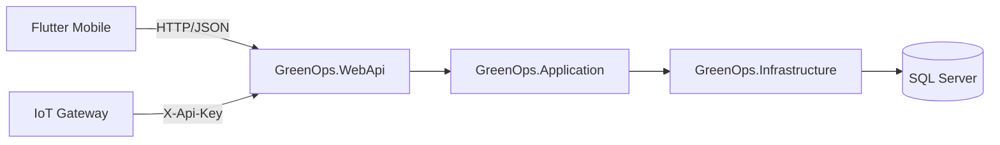

# GreenOps CarbonTrace - Teknik Proje Raporu

Bu dokuman, GreenOps CarbonTrace platformunun teknik mimarisini, calisma bicimini ve gelistirme ortami kurulumunu aciklar.

GreenOps CarbonTrace; karbon emisyonlarinin kaydi, izlenmesi, raporlanmasi ve yonetimi icin tasarlanmis cok kiracili (multi-tenant) bir platformdur.

## 1. Proje Ozeti

Platform 2 ana katmandan olusur:

- Backend: .NET 8 Web API, JWT kimlik dogrulama, EF Core SQL Server
- Mobil istemci: Flutter (Android emulator hedefli gelistirme)

Ana islevler:

- Kimlik dogrulama (TOTP 2FA dahil), rol bazli erisim ve sirket (tenant) izolasyonu
- Emisyon girisi (faaliyet donemi + katsayi denetim izi), onay/red surecleri ve CSV toplu yukleme
- Dashboard KPI ve trend analizleri
- Sirket, tesis, kullanici ve tedarikci yonetimi
- Hedef, karbon kredisi, lisans ve faturalama modulleri
- Yetki kontrollu dokuman yukleme/indirme
- CSV veri export (ISO 14064 / GHG Protocol PDF uretimi henuz yok)
- Entegrasyonlar (hash'li API anahtari, X-Api-Key ile IoT sayac webhook'u)
- Tum veri degisiklikleri icin otomatik denetim logu

## 2. Mimari



- GreenOps.Domain: Entity modelleri
- GreenOps.Application: Servis sozlesmeleri, MediatR komutlari ve FluentValidation pipeline'i
- GreenOps.Infrastructure: EF Core DbContext, repository'ler, servisler, guvenlik yardimcilari (BCrypt, TOTP, token hash), dosya depolama, denetim interceptor'u
- GreenOps.WebApi: Controller'lar (`ApiControllerBase` uzerinden tenant/rol kontrolu), JWT, rate limiting, Swagger

## 3. Guvenlik Modeli

- **Tenant izolasyonu:** Sirket kimligi istemciden degil JWT'deki `companyId` claim'inden alinir. Sadece SuperAdmin `companyId` parametresiyle baska sirket secebilir. Baska sirkete ait kaynaklar 404 doner.
- **Roller:** SuperAdmin > CompanyAdmin > Manager > Personnel. Kayit olan kullanici yeni bir sirket acar ve onun CompanyAdmin'i olur; mevcut sirkete katilim sadece davetle olur. CompanyAdmin en fazla Manager/Personnel atayabilir.
- **Oturum:** Her istekte kullanicinin aktifligi, rolu ve sirketi DB'den dogrulanir; pasife alinan veya rolu degisen kullanicinin token'i aninda gecersiz olur. Sifre degisince refresh token'lar iptal edilir.
- **Gorevler ayriligi:** Veriyi giren kisi kendi kaydini onaylayamaz; onaylanmis kayit silinemez.
- **Gizli degerler:** Sifre sifirlama token'lari ve API anahtarlari DB'de SHA-256 hash olarak saklanir.
- **Rate limit:** Auth uclari IP basina dakikada 10, webhook anahtar basina dakikada 120 istek.
- **Dosyalar:** Uzanti beyaz listesi ve boyut siniri (belge 10 MB, avatar 2 MB); dosyalar web kokunden servis edilmez, yetki kontrollu indirme ucu kullanilir.

## 4. Kurulum ve Calistirma

### 4.1 On Kosullar

- .NET SDK 8.x
- SQL Server (lokal instance, Windows authentication)
- Flutter SDK (Dart 3.8+)
- Android Studio / Android SDK ve bir Android emulator (AVD)

### 4.2 Backend (API)

```powershell
cd backend
dotnet run --project GreenOps.WebApi --launch-profile http
```

- API: `http://localhost:5223`, Swagger: `http://localhost:5223/swagger`
- Baslangicta migration'lar otomatik uygulanir.
- Ilk calistirmada SuperAdmin yoksa olusturulur. `Seed:AdminPassword` bos ise rastgele bir sifre uretilip konsola **bir kez** yazilir.

### 4.3 Flutter (Android emulator)

```powershell
flutter pub get
flutter run -d emulator-5554
```

- Emulator'de `10.0.2.2` host makinenin `localhost`'udur; uygulama varsayilan olarak `http://10.0.2.2:5223/api` adresini kullanir (`lib/services/api_client.dart`).
- Acik metin HTTP sadece `10.0.2.2` icin izinlidir (`android/app/src/main/res/xml/network_security_config.xml`). Baska bir sunucu icin HTTPS kullanin: `flutter run --dart-define=API_URL=https://sunucu/api`.
- VS Code icin `.vscode/launch.json` icinde "GreenOps (Android emulator)" yapilandirmasi vardir.

## 5. Konfigurasyon

`backend/GreenOps.WebApi/appsettings.json`:

- `ConnectionStrings:DefaultConnection`: SQL Server baglantisi
- `Jwt:Key`: **bos birakilmistir**. En az 32 bayt olmali; yoksa uygulama baslamaz. Gelistirme anahtari `appsettings.Development.json` icindedir; uretimde `Jwt__Key` ortam degiskeni veya secret store kullanin.
- `Jwt:Issuer`, `Jwt:Audience`, `Jwt:ExpiresMinutes`
- `Seed:AdminEmail`, `Seed:AdminPassword`: ilk SuperAdmin
- `Storage:Root`: yuklenen dosyalarin kok dizini (varsayilan: calisma dizini/uploads)
- `Auth:LogResetTokens` (sadece Development): e-posta servisi olmadigi icin sifre sifirlama token'ini log'a yazar

## 6. Yapay Zeka (yerel Ollama)

Bulut AI servisi kullanilmaz; modeller backend'in calistigi makinedeki Ollama'da calisir (`Ai:*` ayarlari).

| Islev | Model | Nasil |
|---|---|---|
| Faturadan okuma (`POST /api/ai/invoice-scan`) | qwen3-vl:8b → gemma4:12b | qwen3-vl gorseli duz metne cevirir (OCR); gemma4 metinden tuketim/birim/donem cikarir (JSON semasi). Sonuc sadece **oneridir**, kullanici kontrol edip kaydeder. |
| Ongoruler (`GET /api/ai/insights`) | gemma4:12b | Tahmin (son 6 ayin dogrusal egilimi) ve anomali (kategori medyaninin 3 kati) **kodda** hesaplanir; model sadece ozet ve oneri yazar. 30 dk onbellek. |
| Asistan (`POST /api/ai/chat`) | gemma4:12b | Sirketin onayli verisiyle sinirli; kayit olusturamaz/onaylayamaz. |

Not: qwen3-vl'ye dogrudan JSON istendiginde dusunme ciktisinda takildigi gozlendi; bu yuzden iki asamali yapi kullanilir. Iki model ayni anda VRAM'e sigmazsa ilk fatura okumasi model yukleme suresi nedeniyle uzayabilir.

## 7. Emisyon Katsayilari — ONEMLI

Her katsayi kaynagini ve dogrulanma durumunu saklar; uygulama bunu kayit detayinda gosterir. Ayrintilar ve baglantilar: `KAYNAKLAR.md` bolum 5.

| Kategori | Kullanilan deger | Durum |
|---|---|---|
| Elektrik | **0,469 kgCO2e/kWh** (2023) | **Resmi.** ETKB, *Turkiye Elektrik Uretimi ve Elektrik Tuketim Noktasi Emisyon Faktorleri Bilgi Formu* (ETKB-EVCED-FRM-042), dagitim hattindan bagli tuketim noktasi |
| Dogalgaz | 2,0 kgCO2e/m3 | **Yer tutucu, kaynaksiz** — sunumda "ornek katsayi" denmeli |
| Motorin | 2,7 kgCO2e/L | **Yer tutucu, kaynaksiz** — sunumda "ornek katsayi" denmeli |

Ilk surumdeki kaynaksiz elektrik degeri (0,5) pasife alindi; o degerle daha once hesaplanmis kayitlar degismez. Iletim hattina bagli tesisler icin resmi deger 0,436'dir (ayni belge).

Dogalgaz / motorin icin dogrulanmis kaynak: IPCC 2006, Cilt 2, Bolum 2, Tablo 2.2: 56.100 / 74.100 kg CO2 per TJ (net isil deger). m3 veya litre basina cevirmek icin yakitin isil degeri gerekir; bu donusum henuz yapilmadi.

Dikkat: ETKB'nin OM/BM/CM degerlerini iceren *Ulusal Elektrik Sebekesi Emisyon Faktoru* formu yenilenebilir enerji projelerinin azaltim hesabi icindir; Scope 2 tuketim emisyonu icin kullanilmaz.

Katsayilar `POST /api/factors/custom` (SuperAdmin) ile eklenir; `source` alani zorunludur (kaynaksiz katsayi girilemez). Her emisyon kaydi hesaplandigi katsayiyi saklar, bu yuzden katsayi degisikligi eski kayitlari degistirmez. Bir kaydin katsayisi, faaliyet doneminin yilina esit veya daha onceki en guncel **aktif** katsayidir; 2023 oncesi elektrik donemleri icin katsayi tanimli olmadigindan kayit olusturulamaz.

## 8. Bilinen Eksikler

- E-posta servisi yok (davet, sifre sifirlama, tedarikci daveti).
- ISO 14064 / GHG Protocol PDF raporu yok; ilgili uclar acik hata doner. Veri CSV olarak alinabilir.
- AI fatura okuma sadece gorsel (png/jpg/webp) kabul eder; PDF desteklenmez.
- Odeme entegrasyonu yok; paket yukseltmede fatura "Pending" olusur.
- Karbon kredileri tCO2e, emisyonlar kgCO2e cinsindendir.
- Otomatik birim/entegrasyon test projesi yok (uctan uca test betikleri manuel calistirildi).

## 9. Lisans

Bu repositoride acikca belirtilmis bir lisans dosyasi bulunmuyorsa, tum haklar proje sahibine aittir.

## 10. 2026 Stratejik Ufuk: Turkiye'de Enerji Donusumu, Karbon Ekonomisi ve Genc Liderler Icin Yol Haritasi

Bu bolum, teknik urun dokumantasyonuna ek olarak 2026 perspektifinde enerji donusumu, karbon ekonomisi ve yonetisim alaninda stratejik bir cerceve sunar.

### 10.1 Giris: 2026 Donum Noktasinda Kuresel ve Ulusal Durum Analizi

2026 yili; kuresel hukuk ortaminda hizlanan iklim baskilari, evrilen jeopolitik ittifaklar ve ulus devletlerin stratejik yeniden konumlanmalarinin kesistigi belirleyici bir donum noktasi olarak tanimlanmaktadir. Bu tarih, yalnizca takvimsel bir gecis degil; enerji, sanayi ve surdurulebilirligin gelecegi hakkinda cesurca dusunmeyi zorunlu kilan yeni bir enerji caginin baslangicidir.

Kuresel olcekte nukleer teknolojilerdeki canlanma, kritik mineraller uzerindeki sert rekabet ve sikilasan iklim regulasyonlari, piyasa egemenliginin yeni parametrelerini belirlemektedir. Turkiye acisindan bu surec; regulatif uyumu bir maliyet yukunden cikarip stratejik pazar hakimiyeti aracina donusturme firsatidir.

Bu yeni duzende asagidaki iki unsur stratejik onkosul niteligindedir:

- Uyum maliyeti optimizasyonu
- Yesil finansman ekosistemine erisim

Donusumu yalnizca takip eden degil, yasal ongoruyu kurumsal stratejisine entegre eden aktorler, kuresel deger zincirlerinde kalici yer edinecektir.

### 10.2 Yeni Enerji Kaynaklari: Nukleer Ronesans ve Kritik Minerallerin Jeopolitigi

Turkiye'nin nukleer enerji hedefi, nukleer enerjinin surdurulebilir enerji stratejilerinde guvenilir bir dayanak olarak yeniden mesruiyet kazanmasiyla es zamanli bir ivme yakalamistir. Ozellikle Kucuk Moduler Reaktorler (KMR/SMR) etrafindaki teknolojik sicrama, 2026 yilinda yeni lisanslama yollarini ve sinir otesi teknoloji transferini hizlandiracaktir.

Nukleer enerji, Turkiye'nin AB Sinirda Karbon Duzenleme Mekanizmasi (CBAM) karsisinda ihracatciya dusuk karbonlu baz yuk elektrigi sunabilmesinin kritik stratejik araclarindan biri olarak konumlanmaktadir.

Enerji donusumunun hammadde ayaginda ise kritik mineraller icin petrolun ilk donemlerine benzer bir jeopolitik rekabet yasanmaktadir. Turkiye, transit ve isleme merkezi potansiyelini korurken ciddi yasal ve ESG/CSY gerilimleriyle de karsi karsiyadir. Ornek olarak zeytinliklerin madencilik faaliyetlerine acilmasi tartismasi; enerji guvenligi ile cevresel koruma arasindaki regulatif dengelemenin somut bir ornegidir.

### 10.3 Karbon Ekonomisi: CBAM, Iklim Kanunu ve Yeni Ticaret Rejimi

2026 itibariyla AB CBAM'in tam kapasite devreye girmesi, Turk ihracatcisi icin karbon performansinin fiyat ve kalite kriterlerinin onune gectigi yeni bir donemi baslatacaktir. Ozellikle su sektorler karbon yogunlugu uzerinden test edilmektedir:

- Demir-celik
- Cimento
- Aluminyum
- Gubre
- Elektrik
- Hidrojen

Emisyon beyani yapmayan veya yuksek karbon ayak izine sahip firmalarin AB pazarinda ek vergi ve rekabet dezavantaji riski artmaktadir.

Turkiye'nin cevabi yeni iklim rejimi kapsaminda Iklim Kanunu ve Emisyon Ticaret Sistemi (ETS) ile sekillenmektedir. Kurumsal kapasite insasi adina, 11-12 Subat 2026 tarihlerinde TSE tarafindan duzenlenecek TS EN ISO 14067 Urun Karbon Ayak Izi Egitimi kritik bir adim olarak degerlendirilmektedir.

- Egitim ucreti: 8.232 TL
- Ogrenci indirimi: %25

### 10.4 Dijital Donusum: GreenOps ve CarbonTrace ile Kurumsal Karbon Yonetimi

Excel tabanli manuel veri toplama yontemleri, Scope 3 emisyonlarinin olcum zorlugu ve denetlenebilir veri altyapisi eksikligi; kurumlar icin operasyonel ve hukuki riskler olusturmaktadir. Bu noktada yerel yazilim cozumleri, yuksek lisans bedelli global urunlere gore ciddi maliyet avantaji saglayabilmektedir.

Ornek maliyet perspektifi:

- Kuresel paketler: yaklasik 25.000 - 150.000 USD
- Yerel paketler (basic baslangic): yaklasik 1.500 - 3.000 USD

#### GreenOps ve CarbonTrace Teknik Mimari Ozeti (mevcut durum)

> Bu tablo kodda **gercekten bulunan** ozellikleri listeler. "Planlanan" sutunu henuz yapilmamis hedeflerdir; sunumlarda bu ayrim korunmalidir.

| Bilesen | Mevcut (kodda calisan) | Planlanan |
|---|---|---|
| Mimari | .NET 8 katmanli mimari (Domain / Application / Infrastructure / WebApi), MediatR + FluentValidation | Tam CQRS ayrimi |
| Veri katmani | SQL Server + EF Core, denetim icin degismez audit log | PostgreSQL destegi, Redis onbellek |
| Veri toplama | Yerel AI ile fatura gorselinden okuma (qwen3-vl OCR + gemma4), CSV toplu yukleme, API anahtarli IoT sayac webhook'u | Enerji saglayici API baglantilari, PDF fatura okuma |
| Metodoloji | GHG Protokolu kapsam (Scope 1/2/3) siniflandirmasi, faaliyet donemi ve kullanilan katsayinin kayitla birlikte saklanmasi | ISO 14064 / 14067 rapor ciktisi, dogrulanmis ulusal katsayi seti |
| Guvenlik | BCrypt sifre, JWT + refresh token rotasyonu, TOTP 2FA, sirket (tenant) izolasyonu, rate limiting, hash'li API anahtarlari | Veritabani seviyesinde sifreleme (TDE / alan sifreleme) |

Yerel platformlar; Turkiye Iklim Kanunu'na hizli adaptasyon, maliyet avantaji ve veri egemenligi acisindan stratejik kaldirac gorevi gorebilir.

### 10.5 Demokratik Yonetisim: Yerel Iklim Politikalari ve Sivil Katilim

Iklim degisikligi ile mucadele, yalnizca teknokratik bir surec degil; seffaflik ve hesap verebilirlik temelli bir demokratik yonetisim alanidir.

Ilgili hukuki cerceve:

- 5393 sayili Belediye Kanunu (Madde 13)
- 4982 sayili Bilgi Edinme Kanunu

Yerel iklim butcelerini ve komisyon tutanaklarini izlemek isteyen paydaslar icin TESEV'in MoDeL (Yerel Iklim Politikalari Izleme ve Katilim Araci) yaklasimi stratejik bir dijital enstruman olarak one cikmaktadir.

#### 2026 Yerel Yonetim Izleme ve Butce Takvimi

- 11 Temmuz: Birimlerin gider teklifleri ve performans fislerinin ilgili mudurluklere gonderilmesi
- 21-25 Temmuz: Birimler arasi butce gorusmeleri
- Agustos sonu: Performans Programinin encumene havalesi
- Eylul son hafta: Butce tasarisi ve performans programinin ust yoneticiye sunulmasi
- Ekim: Butce tasarisi ve performans programinin belediye meclisine sunulmasi
- Nisan: Onceki yilin hedeflerini iceren Faaliyet Raporunun meclise sunumu ve denetimi

### 10.6 Sonuc ve Stratejik Cagri: Genc TUYAFED Icin Eylem Plani

2026 stratejik ufku, teknik yetkinligi demokratik denetimle birlestiren liderler icin guclu firsatlar barindirmaktadir. Genc TUYAFED uyeleri icin uc temel oncelik asagidadir:

1. Teknik yetkinlik ve sertifikasyon: TSE ISO 14067 egitimi ile urun karbon ayak izi hesaplamasinda uzmanlasma.
2. Dijital donusum ve yerli yazilim savunuculugu: Excel bagimliligini azaltan, kurumsal entegrasyona uygun yerli platformlara liderlik.
3. Veriye dayali yerel denetim: MoDeL gibi araclarla Temmuz ve Ekim butce dongulerinde iklim taahhutlerinin izlenmesi.

2026'nin kazananlari, regulasyonlari engel olarak degil stratejik mimarilerinin temel tasi olarak konumlandirabilenler olacaktir.
